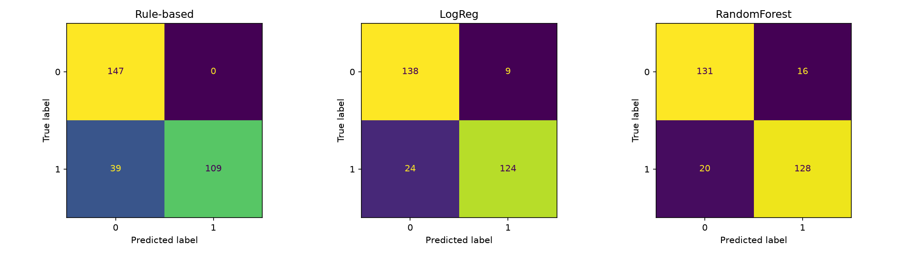
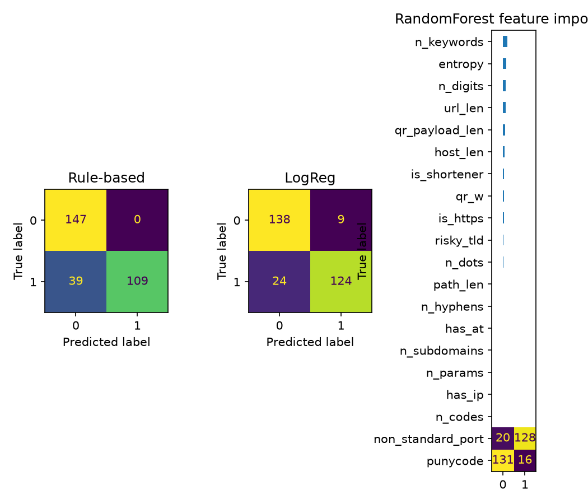

# Detecting Malicious QR Codes Through URL and Structural Analysis

## Problem
QR codes hide the URL they contain, so people cannot judge a link before opening it.

## Research Question
How effectively can URL-based features identify potentially malicious QR codes, and what limitations arise when QR codes contain shortened URLs?

## Method
1. Build a labelled dataset of malicious and benign URLs
2. Generate a QR image for each URL (about 20% replaced by simulated short links)
3. Decode the images with OpenCV (pyzbar is used when available)
4. Extract URL and QR structural features
5. Compare a rule-based detector, Logistic Regression and Random Forest
6. Evaluate false positives and false negatives, including a "shortener flag" mitigation

## Dataset
[Write here: synthetic sample data OR OpenPhish/PhishTank + Tranco. State clearly which you used.]

## Results
| Method | Non-shortened accuracy | Shortened accuracy |
|---|---|---|
| Rule-based | 96% | 50% (malicious recall 0%) |
| Logistic Regression | 100% | 45% |
| Random Forest | 100% | 40% |

| Method | Malicious recall | False negatives | False positives |
|---|---|---|---|
| Rule-based | 74% | 39 | 0 |
| Rule + shortener flag | 94% | 9 | 30 |

## Discussion
URL features work well when the URL is visible, but all methods fall to roughly chance level on shortened links because the short URL hides the destination. Flagging all shortened links recovers malicious recall (0% to 100% on shortened links) but raises false positives, since safe short links are flagged too.

## Limitations
- [If synthetic data: results are inflated because the data is easy to separate]
- QR images are clean and computer-generated, unlike real photos
- Shorteners were simulated, with no real redirects
- Static features only: no content, WHOIS or reputation checks

## How to Run
pip install -r requirements.txt
python src/build_dataset.py
python src/generate_qr.py
python src/run_experiment.py

## Future Work
Safe redirect expansion in a sandbox, domain-age features, testing on photographed QR codes.